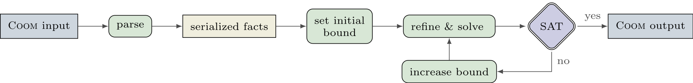

# Cargo Bike

The Cargo Bike is a product configuration problem
written in the [COOM\[X*\]][xoomstar] language fragment.
As this example contains unbounded cardinalities,
the current encoding is not able to solve this natively.
Therefore, the *COOM Suite* searches for the minimal upper bound for which the problem is satisfiable:
a maximum bound replaces the unbounded cardinalities and is increased until reaching a solution.
This approach is captured in the following diagram.



How the maximum bound is increased can be controlled with the options described in [bound search][bound-search].

!!! info "Acknowledgements"
    The Cargo Bike example has been provided by [denkbares].

[xoomstar]: ../reference/coom/index.md#unbounded-cardinalities
[denkbares]: https://denkbares.com
[bound-search]: #bound-search

## Usage

```console
coomsuite solve examples/coom/bike/cargo-bike.coom -u examples/coom/bike/user-input-cargo.coom --bounds linear
```

## Bound search

The search for the minimal bound is configured by the following options:

- `--bounds linear` (default): the maximum bound is increased by a fixed step size,
  given by the option `--step` (default 1).
  E.g. with `--step 2` the bounds 0, 2, 4, ... are solved.
- `--bounds exponential`: the maximum bound is increased exponentially,
  i.e. the bounds $\lceil base^n \rceil$ are solved, where the base is given by the option `--base` (default 2.0).
  E.g. the default base solves the bounds 0, 1, 2, 4, 8, ...,
  while with `--base 1.5` the bounds 0, 1, 2, 3, 4, 6, 8, ... are solved (repeated values are skipped).
- `--initial-bound` (default 0): the first bound to solve.
  The following bounds are computed as above, e.g. `--bounds exponential --initial-bound 5` solves 5, 8, 16, ...

Once a satisfiable bound is found, the minimal bound is found by bisection between
the last unsatisfiable and the satisfiable bound.
If the model contains an optimization statement,
optimization is ignored during the search and the problem is solved once more with the minimal bound to optimize.

## Multi-shot solving

By default the standard COOM encoding is used for each bound,
i.e. the problem is grounded and solved from scratch for every bound.
To avoid repeatedly grounding (and solving) the same parts of the problem,
the COOM suite also includes a [multi-shot encoding][multi-shot].
It can be used by adding the option `--multishot` (`-m`).

```console
coomsuite solve examples/coom/bike/cargo-bike.coom -u examples/coom/bike/user-input-cargo.coom --multishot
```

!!! warning "Limitations"
    - Multi-shot solving is only supported for clingo, using it together with `-s flingo` raises an error.

### Grounding strategies

The option `--grounding` selects how bounds are grounded when the maximum bound is increased by more than one
(e.g. with `--bounds exponential` or a linear `--step` larger than 1):

- `stepwise` (default): every bound in between is preprocessed and grounded individually.
- `jump-extend` and `jump-full`: only the incremental parts of the problem
  (e.g. aggregates over the bags) are grounded at the bounds that are actually solved.
  The variants differ in how incremental aggregates are grounded:
  `jump-extend` extends the value of the previously solved bound,
  while `jump-full` recomputes the full aggregate at each solved bound.

See [grounding strategies][grounding] for details.

### Fixing externals

The bounds are switched on and off using externals,
which allows to search for the minimal bound without grounding again.
With the option `--fix-externals`, externals whose value can not change anymore are fixed permanently:
e.g. once a bound is unsatisfiable, all smaller bounds stay active for the rest of the search.
See [fixing externals][fix-externals] for details.

[multi-shot]: ../reference/encodings/multishot/index.md
[grounding]: ../reference/encodings/multishot/index.md#grounding-strategies
[fix-externals]: ../reference/encodings/multishot/index.md#fixing-externals

## COOM model

<!-- ??? quote "COOM Model" -->
<!-- title="Cargo Bike" linenums="1" -->
```cpp
--8<-- "examples/coom/bike/cargo-bike.coom:5:33"
```

## Example solution

```shell
Solving with max_bound = 1
UNSATISFIABLE

Solving with max_bound = 2
UNSATISFIABLE

Solving with max_bound = 3
Answer: 1
bags[0]
bags[1]
bags[2]
requestedVolume[0] = 60
totalVolume[0]     = 60

bags[0].size[0] = "large"
bags[0].size[0].volume[0] = 20
bags[0].size[0].weight[0] = 25

bags[1].size[0] = "large"
bags[1].size[0].volume[0] = 20
bags[1].size[0].weight[0] = 25

bags[2].size[0] = "large"
bags[2].size[0].volume[0] = 20
bags[2].size[0].weight[0] = 25

SATISFIABLE

```
